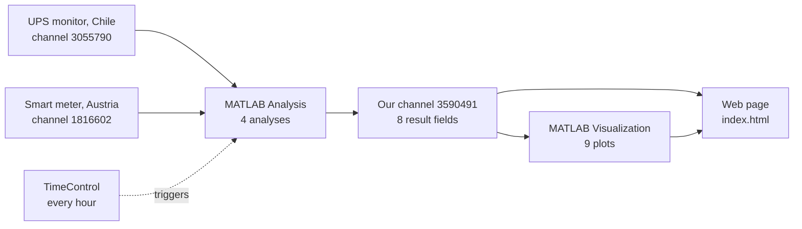

# Power Quality Analytics

An IoT analytics project for BEE3033 Data Communication & Networks at UCSI University. Two public power meters, one in Chile and one in Austria, publish their readings to ThingSpeak. Every hour a MATLAB script reads both, calculates standard power quality indicators, and stores the results in our own channel. A web page shows the results.

**Live page:** https://aaloraini.com/Power-Quality-Analytics/
**Our ThingSpeak channel:** [3590491](https://thingspeak.mathworks.com/channels/3590491)

## How it works



1. Collect. The two source channels post a reading every 20 to 30 seconds.
2. Analyse. Once an hour, TimeControl runs the analysis script. It reads the last 60 minutes from both channels, applies the equations below to every reading, and averages each result.
3. Store. The script writes 8 averaged results to channel 3590491 as one entry.
4. Visualise. MATLAB Visualization plots 14 days of each result with the relevant limit lines.
5. Publish. The web page embeds the plots and reads the latest values from the channel's public API.

Data collection started on 20 November 2026.

## Data sources

| | Source A | Source B |
|---|---|---|
| Channel | [BigMeow UPS monitor, 3055790](https://thingspeak.mathworks.com/channels/3055790) | [Smartmeter, 1816602](https://thingspeak.mathworks.com/channels/1816602) |
| Equipment | HPE T1500 G5 tower UPS | Utility smart meter on a house with rooftop PV |
| Location | Chile | Austria (EVN network) |
| Supply | Single-phase, 220 V, 50 Hz | Three-phase, 230 V, 50 Hz |
| Fields used | V-in, V-out, power, current, efficiency | Net power, phase voltages L1, L2, L3 |

Both channels were chosen after checking 60 days of history: each had a reading in every hour, with no gap longer than two hours.

## Analyses

Each equation runs on every reading in the 60-minute window. Readings with no load or zero efficiency are discarded before averaging.

**1. Apparent power and power factor (Source A)**

$$S = V_{rms} \, I_{rms} \qquad PF = \frac{P}{S}$$

**2. UPS conversion losses (Source A)**

$$P_{in} = \frac{P_{out}}{\eta / 100} \qquad P_{loss} = P_{in} - P_{out}$$

**3. Voltage deviation from nominal (Sources A and B)**

$$\Delta V\% = \frac{V - V_{nom}}{V_{nom}} \times 100$$

with $V_{nom}$ = 220 V for Chile and 230 V for Austria. EN 50160 allows ±10%.

**4. Three-phase voltage unbalance (Source B)**, using the NEMA line voltage unbalance rate:

$$V_{avg} = \frac{V_{L1} + V_{L2} + V_{L3}}{3} \qquad LVUR\% = \frac{\max \lvert V_{Li} - V_{avg} \rvert}{V_{avg}} \times 100$$

EN 50160 sets a limit of 2%.

### Result fields in channel 3590491

| Field | Result | Unit | Source |
|---|---|---|---|
| 1 | UPS apparent power | VA | A |
| 2 | UPS power factor | | A |
| 3 | UPS losses | W | A |
| 4 | UPS voltage deviation | % | A |
| 5 | Smart meter average phase voltage | V | B |
| 6 | Smart meter voltage unbalance | % | B |
| 7 | Smart meter voltage deviation | % | B |
| 8 | Smart meter net power (positive = import, negative = export) | W | B |

## Visualizations

| Script | Shows |
|---|---|
| `field1_ups_apparent_power.m` | Apparent power with its mean |
| `field2_ups_power_factor.m` | Power factor against the ideal value of 1 |
| `field3_ups_losses.m` | UPS losses with their mean |
| `field4_ups_voltage_deviation.m` | Chile voltage deviation against the ±10% limits |
| `field5_sm_average_voltage.m` | Austria phase voltage against 207 V and 253 V |
| `field6_sm_voltage_unbalance.m` | Austria unbalance against the 2% limit |
| `field7_sm_voltage_deviation.m` | Austria voltage deviation against the ±10% limits |
| `field8_sm_net_power.m` | Austria net power, showing solar export |
| `voltage_deviation_comparison.m` | Chile and Austria voltage deviation on one plot |

Each plot covers the last 14 days and shows the mean, minimum and maximum in its title.

## Web page

`index.html` shows the 9 plots in three groups:

1. Comparison: Chile and Austria voltage deviation on one plot
2. Chile UPS: Fields 1 to 4
3. Austria smart meter: Fields 5 to 8

Each panel header also shows the latest hourly value, read from the channel's public API when the page loads.

## Repository layout

```
index.html                        web page (static, no build step)
matlab/
  analysis/
    power_quality_analysis.m      hourly analysis, run by TimeControl
  visualization/
    field1 ... field8 *.m         one plot per result field
    voltage_deviation_comparison.m
```

## Reproducing it

1. Create a ThingSpeak channel with the 8 fields listed above.
2. Create a MATLAB Analysis app, paste `power_quality_analysis.m`, and enter your channel ID and Write API key.
3. Create a TimeControl that runs the analysis every hour.
4. Create one MATLAB Visualization per script in `matlab/visualization`, changing `readChannelID` to your channel.
5. Make the channel public, then replace the channel ID and visualization IDs in `index.html`.

The Write API key in this repository is masked. Never commit a real key.

## Team

- Aloraini Abdulhakim
- Mohanad Baqais
